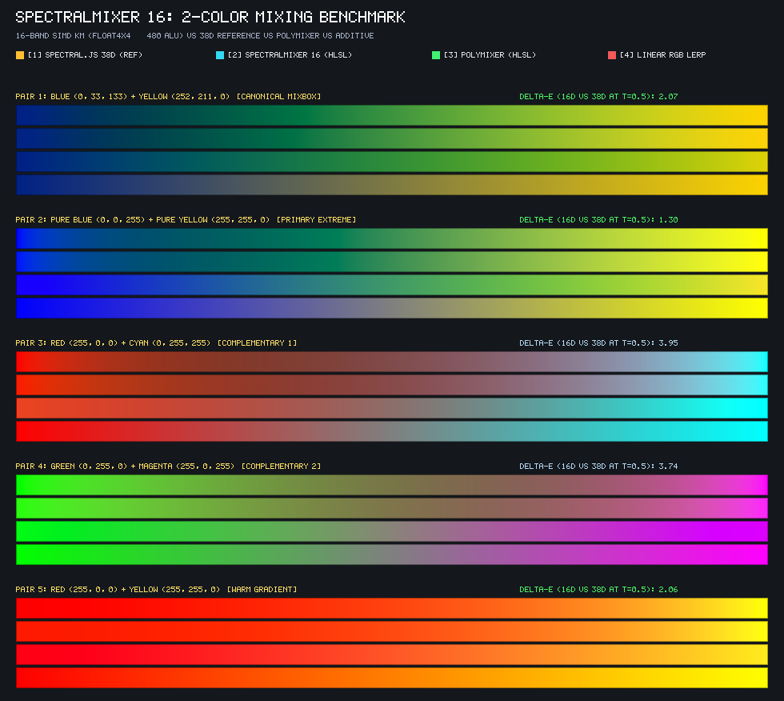
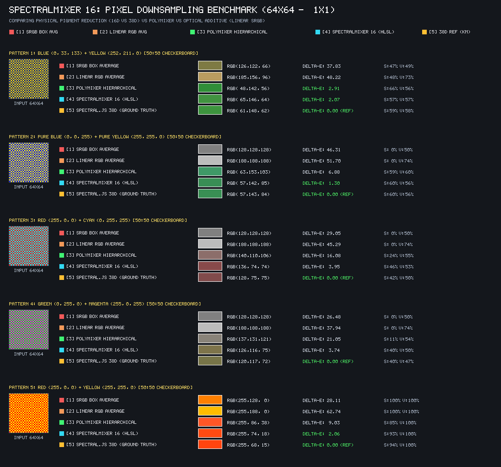

# Generic Pigment Mixer for Unity

[English](README.md) | **日本語**

[](https://openupm.com/packages/jp.nobnak.generic_pigment_mixer/)
[](https://unity.com/)
[](LICENSE)


*上図: 青（0, 33, 133）＋ 黄（252, 211, 0）などの 2 色混色。通常の加色（Linear RGB Lerp）では灰色にくすむ領域が、本パッケージの物理モデル（SpectralMixer 16）や多項式近似（PolyMixer）では、絵の具本来の鮮やかな緑色になります。*

---

Unity 向けのリアルタイム物理混色（減法混色・顔料ブレンディング）パッケージ **[jp.nobnak.generic_pigment_mixer](https://openupm.com/packages/jp.nobnak.generic_pigment_mixer/)** です。

デジタル加色混合（RGB Lerp）で生じる「青＋黄が灰色や黄土色に濁る現象」や、テクスチャ縮小（Mipmap / Box 平均）による色の沈みを解消し、現実の絵の具のような自然で鮮やかな発色を実現します。

**テクスチャや 3D LUT を一切使用しない（0 byte）** ため、メモリを消費せず、モバイルから HDR レンダリングまで極めて低コストに組み込めます。

## 主な特徴

- ⚡ **PolyMixer (最速・多項式近似)**: 4 次多項式回帰モデル。約 330 FMA のみで Mixbox 近似の混色を実現。2 色グラデーション演出やゲームのリアルタイム 3D 描画に最適。
- 🎨 **SpectralMixer 16 (高精度・16 バンド SIMD 物理モデル)**: 16 波長 Kubelka-Munk 散乱吸収モデル（約 480 ALU）。完全 Linear RGB（HDR ネイティブ）対応、3 色以上の同時調合、テクスチャ縮約に最適。
- 🧪 **物理アキュムレーション (Accumulator API)**: 潜在スペクトル空間（吸光散乱比 $K/S$）で多数の色や画素を順序依存性なく直接加算蓄積。重い逆算を最後に 1 度だけ解く効率的なパイプライン。
- 📉 **物理画素ダウンサンプリング**: チェッカーボードや高周波テクスチャを物理混色で平均化し、濁りのない自然な Mipmap / 縮小画像を生成。
- 🛠️ **マルチプラットフォーム対応**: HLSL シェーダー include、C# スクリプト、Shader Graph（Custom Function Node）のすべてで共通して利用可能。

---

## インストール

[OpenUPM](https://openupm.com/packages/jp.nobnak.generic_pigment_mixer/) または Git URL からインストールできます。

### 方法 1: OpenUPM からインストール（推奨）

#### A. OpenUPM CLI で追加
```bash
openupm add jp.nobnak.generic_pigment_mixer
```

#### B. Unity エディタで Scoped Registry を設定
1. Unity メニューの **Edit → Project Settings → Package Manager → Scoped Registries** を開きます。
2. 以下の項目を追加して **Save** します：

| 項目 | 設定値 |
| :--- | :--- |
| **Name** | `package.openupm.com` |
| **URL** | `https://package.openupm.com` |
| **Scope(s)** | `jp.nobnak` |

3. **Window → Package Manager** を開き、左上のメニューから **My Registries** を選択して **Generic Pigment Mixer** をインストールします。

#### C. `Packages/manifest.json` を直接編集
```json
{
  "dependencies": {
    "jp.nobnak.generic_pigment_mixer": "1.0.0",
    "com.unity.mathematics": "1.2.6"
  },
  "scopedRegistries": [
    {
      "name": "package.openupm.com",
      "url": "https://package.openupm.com",
      "scopes": [
        "jp.nobnak"
      ]
    }
  ]
}
```

---

### 方法 2: Git URL でインストール

Unity Package Manager の **「+」→「Add package from git URL...」** に以下を入力します：

```text
https://github.com/nobnak/generic-pigment-mixer.git?path=/Packages/jp.nobnak.generic_pigment_mixer
```

特定バージョン（タグ）を指定する場合：
```text
https://github.com/nobnak/generic-pigment-mixer.git?path=/Packages/jp.nobnak.generic_pigment_mixer#v1.0.0
```

---

## クイックスタート

### 1. HLSL シェーダーでの利用

#### A. 2色の顔料混色（SpectralMixer 16 / Linear RGB）
```hlsl
#include "Packages/jp.nobnak.generic_pigment_mixer/ShaderLibrary/SpectralMixer16.hlsl"

// 比率 t (0.0~1.0) で 2 色を物理混色 (Linear RGB)
float3 mixedLinear = Spectral16_Lerp(colA_Linear.rgb, colB_Linear.rgb, t);
```

#### B. 2色の顔料混色（PolyMixer / 最速）
```hlsl
#include "Packages/jp.nobnak.generic_pigment_mixer/ShaderLibrary/PolyMixer.hlsl"

// 比率 t (0.0~1.0) で多項式混色 (sRGB または Linear)
float3 mixedColor = PolyMixer_Lerp(colA.rgb, colB.rgb, t);
```

#### C. 4画素の物理平均化（2x2 ダウンサンプリング）
```hlsl
#include "Packages/jp.nobnak.generic_pigment_mixer/ShaderLibrary/SpectralMixer16.hlsl"

// 4つの Linear RGB ピクセルを物理的に縮約（灰色に濁らない Mipmap 等）
float3 downsampled = Spectral16_Downsample2x2(c00, c10, c01, c11);
```

#### D. 多数色・画素ブロックの物理アキュムレーション（Accumulator API）
```hlsl
#include "Packages/jp.nobnak.generic_pigment_mixer/ShaderLibrary/SpectralMixer16.hlsl"

// 1. アキュムレータ初期化
Spectral16_Accum acc = Spectral16_Accum_New();

// 2. 多数の色/画素を加算蓄積（Linear RGB, weight, tinting strength）
// 潜在スペクトル空間（K/S比）で線形加算されるため、加算順序に依存しません
Spectral16_Accum_Add(acc, pixelA_Linear, weightA);
Spectral16_Accum_Add(acc, pixelB_Linear, weightB);
Spectral16_Accum_Add(acc, pixelC_Linear, weightC);

// 3. 最後に 1 回だけ RGB に復元（重い KM 逆算・XYZ 積分は 1 度のみ実行）
float3 finalLinear = Spectral16_Accum_Resolve(acc);
```

### 2. C# スクリプトでの利用

```csharp
using UnityEngine;

// 1. PolyMixer (4次多項式)
Color polyMixed = PolyMixer.Lerp(colorA, colorB, t);

// 2. SpectralMixer 16 (16バンド KM)
Color spectralMixed = SpectralMixer16.Lerp(colorA, colorB, t);

// 3. 3色以上の物理調合
Color multiMixed = SpectralMixer16.Mix(
    new Color[] { colorA, colorB, colorC },
    new float[] { 0.5f, 0.3f, 0.2f } // 混合比率
);
```

### 3. Shader Graph での利用
1. **Custom Function** ノードを作成します。
2. **Type**: `File` を選択し、`Packages/jp.nobnak.generic_pigment_mixer/ShaderLibrary/PolyMixer.hlsl`（または `SpectralMixer16.hlsl`）を指定します。
3. **Name**: `PolyMixer_Lerp`（または `Spectral16_Lerp`）
4. **Inputs**: `c1` (Vector3), `c2` (Vector3), `t` (Float)
5. **Outputs**: `Out` (Vector3)

---

## サンプル

Package Manager で **Generic Pigment Mixer** を選択し、**Samples → Pigment Mixing Comparison → Import** をクリックすると、プロジェクト内にサンプルが展開されます。

| サンプルアセット | 内容 |
| :--- | :--- |
| `ColorMixComparison.unity` | リアルタイム混色プレビューシーン（グラデーション帯、スウォッチ、$\Delta E$ 精度表示） |
| `ColorMixSampleDemo.cs` | インタラクティブ混色・5 プリセット・チェッカーボード縮小の切替コントローラー |
| `ColorMixCompare.compute` | コンピュートシェーダーでの多色比較実装 |
| 各種ベンチマーク Runner (`Editor/`) | 画像検証・データテーブル出力ツール |

---

## エンジン選定ガイド

| 比較項目 | **PolyMixer** (最速) | **SpectralMixer 16** (物理・推奨) | 通常の加色 (RGB Lerp) |
| :--- | :--- | :--- | :--- |
| **数理モデル** | 4 次多項式回帰 (Mixbox 近似) | **16 バンド単一定数 KM 物理モデル** | 線形補間 |
| **GPU コスト** | **約 330 FMA** (レジスタ極小) | **約 480 ALU** (float4x4 SIMD) | 1 ALU |
| **青＋黄 ($t=0.5$)** | **鮮やかなエメラルドグリーン** | **深みのあるフォレストグリーン** | **くすんだ黄土色〜灰** |
| **真値との色差** | $\Delta E \approx 2.07$ (vs Mixbox) | **$\Delta E \le 2.62$ (知覚限界未満)** | $\Delta E \approx 37 \sim 46$ (破綻) |
| **多色混色 ($N \ge 3$)** | △ カスケード 2 色混合 | **◎ 1 パス同時混色・着色力指定** | × 単純加色平均 |
| **画素平均化 (縮小)** | △ 階層的 2x2 縮約 | **◎ アキュムレータ線形集約** | × 灰色化 (光学的平均) |
| **入出力色空間** | sRGB / Linear (外側変換) | **完全 Linear RGB (HDR ネイティブ)** | N/A |
| **テクスチャ / LUT** | **不要 (0 byte)** | **不要 (0 byte)** | 不要 |
| **推奨用途** | リアルタイム 3D / モバイルゲーム / ポストプロセス | **HDR 描画 / Mipmap 生成 / ペイントツール** | 明度フェード等 |

---

## 画素ダウンサンプリング検証 (テクスチャ縮約)

高周波なカラーパターン（$64 \times 64$ チェッカーボード）を $1 \times 1$ にダウンサンプリングした際の色保持比較です：



- **通常の光学的平均 (sRGB / Linear Box Avg)**: 青と黄の微細な網点が平均化されると光の加色合成となり、灰色または白っぽく退色します。
- **SpectralMixer 16 / PolyMixer**: 絵の具の粒子が混ざり合った状態として計算されるため、縮小後も鮮やかな中間色（緑）が完全に保持されます。

---

## ディレクトリ構成

```text
Packages/jp.nobnak.generic_pigment_mixer/   # ★ UPM パッケージルート
├── package.json                            # パッケージ定義
├── GenericPigmentMixer.asmdef              # Mathematics 依存アセンブリ
├── Runtime/                                # C# 実装
│   ├── PolyMixer.cs                        # 4 次多項式モデル
│   ├── SpectralMixer16.cs                  # 16 バンド SIMD KM
│   ├── SpectralMixerN.cs                   # 任意次元 (8D/12D/16D/38D) KM
│   ├── SpectralMixer8.cs                   # 8 バンド SIMD KM
│   ├── SpectralMixer.cs                    # 38 波長 Spectral.js 互換
│   └── KubelkaMunk.cs                      # 38 波長物理リファレンス
├── ShaderLibrary/                          # HLSL シェーダー include
│   ├── PolyMixer.hlsl                      # ~330 FMA 最速シェーダー
│   ├── SpectralMixer16.hlsl                # ~480 ALU SIMD 物理シェーダー
│   ├── Spectral16_Constants.inc.hlsl       # 16 バンド定数テーブル
│   └── SpectralMixer.hlsl                  # 38 波長リファレンスシェーダー
└── Samples~/                               # サンプルアセット
    └── Comparison/
        ├── Scenes/ColorMixComparison.unity # 比較検証シーン
        ├── Shaders/ColorMixCompare.compute # 比較用 Compute Shader
        └── ColorMixSampleDemo.cs           # インタラクティブ操作デモ
```

---

## 技術ドキュメント & リファレンス

- [PolyMixer ユーザーガイド & パフォーマンス詳細](Docs/POLYMIXER_USER_GUIDE.md)
- [研究背景・数理モデル比較・Spectral.js 検証ノート](Docs/RESEARCH_AND_COMPARISON.md)

### 謝辞・先行研究
- **PolyMixer**: [filament-mixer](https://github.com/justinh-rahb/filament-mixer) (Justin Hensley) — Apache 2.0 License
- **Spectral.js**: [spectral.js](https://github.com/rvanwijnen/spectral.js) (Rolf van Wijnen) — MIT License
- **Mixbox**: [Mixbox](https://scrtwpns.com/mixbox/) (Secret Weapons)

---

## ライセンス

[LICENSE](LICENSE)（MIT License）を参照してください。
