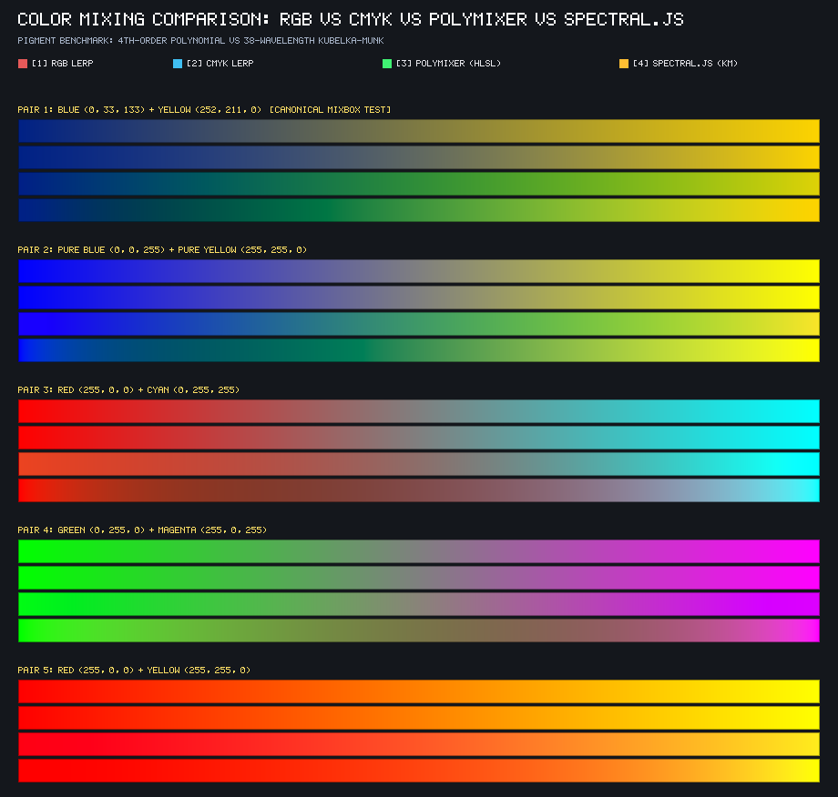

# Generic Pigment Mixer for Unity

**English** | [日本語](README.ja.md)

A real-time physical pigment color mixing library for Unity.  
A complete port of the 4th-degree polynomial model (**PolyMixer**) developed in [justinh-rahb/filament-mixer](https://github.com/justinh-rahb/filament-mixer) to HLSL shaders and C#, eliminating the "muddy colors" (blue + yellow turning into gray) typical of conventional digital additive and subtractive interpolation.

---

## Comparison of Color Mixing Methods

A direct comparison of conventional additive mixing (sRGB Lerp), subtractive mixing (CMYK Lerp), this project's **PolyMixer (HLSL)**, and the physics-based **Spectral.js (Kubelka-Munk)**.



| Mixing Method | Blue + Yellow ($t=0.5$) Behavior | GPU Cost / Memory | Features & Use Cases |
| :--- | :--- | :--- | :--- |
| **[1] Additive (RGB Lerp)** | **Dull ocher to gray** | 1 ALU | Light mixing. Unsuitable for digital paint or texture blending. |
| **[2] Subtractive (CMYK Lerp)** | **Dark blue-gray to gray** | A few ALUs | Ink absorption model. Blue + Yellow darkens and grays out. |
| **[3] PolyMixer (HLSL)** | **Vibrant emerald green** | **~330 FMAs (0 textures)** | **Mixbox-approximated pigment mixing. Ideal for real-time rendering.** |
| **[4] Spectral.js (KM)** | **Deep emerald green** | **1,000+ ALUs (38-iteration loop)** | **38-wavelength single-constant KM physical model. Supports multi-color mixing & tinting strength.** |

---

## Key Features

- **Natural Pigment Mixing (Blue + Yellow = Green)**:
  - Ideal for digital painting, procedural textures, Splatoon-like ink mixing, and material blending.
- **Zero Texture Samplers & 3D LUTs**:
  - Requires no massive 3D LUT textures (dozens of MBs to 192 MB) like original Mixbox, consuming zero VRAM bandwidth.
- **Pure ALU Computation (~330 FMAs)**:
  - Evaluated via straight-line computations with unrolled monomial bases and coefficient tables, finishing within nanoseconds on pixel shaders.
- **Both C# and HLSL Supported**:
  - Produces identical color mixing results across shaders and CPU-side logic (texture pre-baking, game logic, etc.).
- **Spectral.js Implementation Included**:
  - Includes a 38-wavelength Kubelka-Munk physics engine (`SpectralMixer.cs` / `SpectralMixer.hlsl`) for scenarios requiring simultaneous mixing of 3+ colors or tinting strength parameters.

---

## When to Use: PolyMixer vs Spectral.js

| Feature | PolyMixer (Recommended) | Spectral.js |
| :--- | :--- | :--- |
| **Primary Use Cases** | Real-time 3D / Post-processing / Gameplay rendering | Palette mixing tools / Digital painting / Physics experiments |
| **Shader Suitability** | **◎ Optimal** (Low register pressure, loop-free) | **△ Caution** (High register pressure due to 38-iteration loop & arrays) |
| **Mixing Flexibility** | 2-color pair interpolation ($t \in [0, 1]$) | **Simultaneous multi-color ($N \ge 2$) mixing + Tinting strength ($T$)** |
| **Endpoint Invariance** | **Guaranteed** ($t=0 \implies C_1, t=1 \implies C_2$) | Approximate (Small errors during RGB $\to$ Spectral $\to$ RGB conversion) |
| **License** | **MIT License** | **MIT License** |

---

## Quick Start

### 1. Usage in HLSL Shaders

Include `PolyMixer.hlsl` in your `.shader` or `.hlsl` and call `PolyMixer_Lerp`:

```hlsl
#include "Assets/Shaders/PolyMixer.hlsl"

fixed4 frag(v2f i) : SV_Target {
    float3 colA = tex2D(_MainTex, i.uv).rgb;
    float3 colB = _PaintColor.rgb;
    float t = _BlendRatio; // 0.0 ~ 1.0

    // Simply replace standard lerp (Blue + Yellow -> Vibrant Green)
    float3 mixed = PolyMixer_Lerp(colA, colB, t);

    return float4(mixed, 1.0);
}
```

### 2. Usage in Shader Graph
1. Create a **Custom Function** node.
2. **Type**: Select `File` and set `Assets/Shaders/PolyMixer.hlsl`.
3. **Name**: `PolyMixer_Lerp`
4. **Inputs**: `c1` (Vector3), `c2` (Vector3), `t` (Float)
5. **Outputs**: `Out` (Vector3)

### 3. Usage in C# Scripts

```csharp
using UnityEngine;

// Mix Blue (0, 33, 133) and Yellow (252, 211, 0) at 50%
Color blue = new Color(0f / 255f, 33f / 255f, 133f / 255f);
Color yellow = new Color(252f / 255f, 211f / 255f, 0f / 255f);

Color green = PolyMixer.Lerp(blue, yellow, 0.5f);
// green -> RGB(47, 141, 56) (Vibrant green)
```

---

## Directory Structure

```text
├── Assets/
│   ├── Artifacts/
│   │   └── ColorMixing_Comparison.png  # Visual comparison image of 4 methods (RGB/CMYK/PolyMixer/Spectral)
│   ├── Scripts/
│   │   ├── PolyMixer.cs                # 4th-degree polynomial C# implementation
│   │   ├── SpectralMixer.cs            # Spectral.js (38-wavelength KM) C# implementation
│   │   ├── KubelkaMunk.cs              # 38-wavelength KM physics reference implementation (filament-mixer)
│   │   └── Editor/
│   │       └── ColorMixCompareRunner.cs # Editor runner to generate comparison images
│   └── Shaders/
│       ├── PolyMixer.hlsl              # HLSL pigment mixing shader function (Primary)
│       ├── SpectralMixer.hlsl          # Spectral.js HLSL shader function
│       └── ColorMixCompare.compute     # Compute shader for generating comparison images
├── Docs/
│   ├── POLYMIXER_USER_GUIDE.md         # Detailed user guide & performance notes
│   └── RESEARCH_AND_COMPARISON.md      # Research, mathematical comparison, KM method, and Spectral.js verification notes
└── Tools/
    ├── generate_polymixer.ps1          # Script to generate HLSL/C# code from C++ coefficients
    └── filament_mixer_raw.h            # Original C++ header
```

---

## Detailed Documentation

Refer to the following documents for more detailed technical specifications and background:

- [**PolyMixer User Guide & Performance Reference**](Docs/POLYMIXER_USER_GUIDE.md)  
  API signatures, Shader Graph integration, GPU resource breakdown (FMA instructions, bandwidth), and color space recommendations (sRGB / Linear).
- [**Research, Comparison & Technical Report**](Docs/RESEARCH_AND_COMPARISON.md)  
  PolyMixer vs. GPMixer comparison, mathematical analysis of gamut constraints in the Kubelka-Munk model, and residual correction experiments.

---

## Credits & References

- [justinh-rahb/filament-mixer](https://github.com/justinh-rahb/filament-mixer) (MIT License)
- [Mixbox](https://github.com/scrtwpns/mixbox) (Secret Weapons / Sochorová & Jamriška, 2021)
